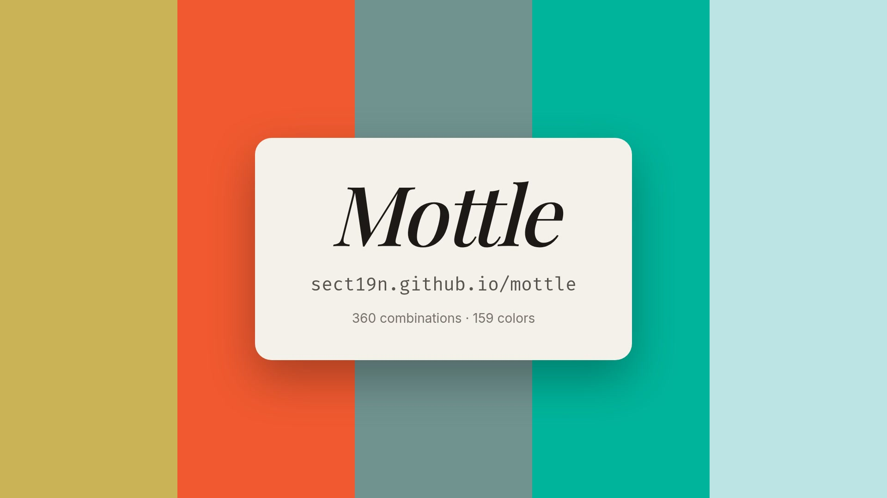

# Mottle

<p align="center">
  
</p>

A digital archive of color combinations from Sanzo Wada's _A Dictionary of Color Combinations, Vol. 1_ (360 combinations).

Mottle is a browsable gallery of the color combinations in Sanzo Wada's 1930s book. Each combination is a palette of two to five named colors, shown with its HEX, RGB and CMYK values so it can be copied straight into a design.

## Features

- **Browse 360 combinations** — filterable gallery, one page per combination (`/combo/1` … `/combo/360`)
- **Filter by palette size** — 2, 3, 4, and 5-color combinations
- **Filter by color** — pick color families or exact colors, with "any" / "all" match mode
- **Search** — by color name or combination ID
- **Save favorites** — bookmark combinations (persisted in your browser)
- **Palette builder** — build your own palette from the book's colors (up to 5 colors) and preview it
- **Dark mode** — light, dark, and system themes

## Develop

```bash
pnpm install
pnpm dev          # http://localhost:3000
pnpm lint
pnpm format       # prettier --write
pnpm build        # static export -> out/
```

Data lives in `data/combinations.json` (edit it and rebuild; there is no CMS).
